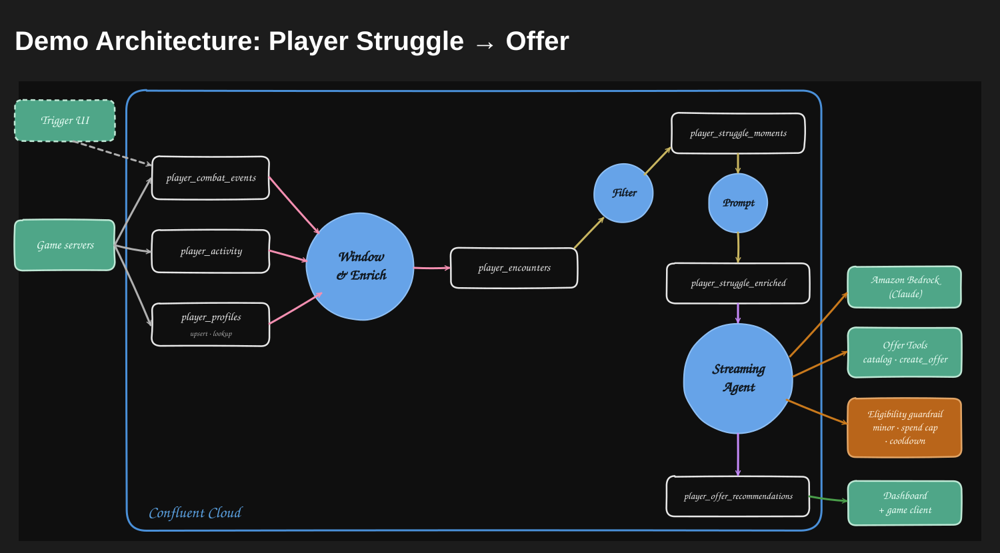

# Demo Walkthrough — From Player Struggle to the Right Intervention, in Real Time

A ~20-minute guided walkthrough to run **after deployment**. It follows one player's struggle left to right through **Stream Lineage** (source topics, the Flink pipeline, the Streaming Agent, the results topic) and then runs it live from the trigger page while the dashboard shows what the player would see.

**The story in one line:** a player keeps dying to the same boss and is about to quit. Confluent Cloud spots the struggle within seconds, enriches it with who the player is, and a Flink **Streaming Agent** (Bedrock Claude) picks the best intervention. Often that's a relevant offer. **Sometimes it decides not to sell** (a minor, a spend cap) and gives something free instead.



**How to position it:**
- Lead with **player experience, retention and responsible monetization**, not "we sold a potion". The moment that lands hardest is the agent *refusing* to upsell a minor.
- **Multi-tenant by design:** one pipeline serves several games, each with its own zones, bosses and catalog. `game_id` rides on every event. This mirrors a platform providing infrastructure for many third-party games.
- **Latency is the product.** An offer that arrives after the player has quit is worthless; that's the case for streaming over batch.

All games, players and items here are **fictional** (no real game IP).

---

## Before you start (5 minutes, not part of the 20)

Everything is deployed (`terraform apply`) and the local apps are up:

```bash
./start-all.sh        # producer + trigger UI (:8080) + dashboard (:8501)
./status.sh           # all three should say RUNNING
```

Open three tabs:

| Tab | URL | Used for |
|---|---|---|
| Confluent Cloud | [Stream Lineage](https://confluent.cloud/go/cluster) for the demo cluster | the architecture walkthrough |
| Trigger | http://localhost:8080 | the buttons |
| Dashboard | http://localhost:8501 | what the player sees; the results |

Give the producer a couple of minutes first so the topics have data and the encounters table has rows. The dashboard reads from `latest`, so **open it before you press any button**.

> [!NOTE]
> Don't press the same button twice while its burst is still running (about 30 s). The trigger page blocks overlapping bursts for the same player.

---

## Section 1 — The data sources: what's flowing in

**1. Open Stream Lineage.** From the cluster page, click **Stream Lineage**. You'll see the whole pipeline as one graph: the producer feeding three source topics, the chain of Flink materialized tables, the results topic, and the dashboard consumer. This one view *is* the architecture, live.

> [!TIP]
> The pipeline is `player_combat_events` + `player_activity` → **`player_encounters`** → **`player_struggle_moments`** → **`player_struggle_enriched`** → **`player_offer_recommendations`**. `player_profiles` feeds the join inside `player_encounters`.

**2. Click the producer (`gaming-demo-producer`).** It simulates about 50 players across three fictional games: *Ember Throne* (dark-fantasy action RPG), *Starlane Arena* (sci-fi arena shooter) and *Tidal Rogue* (naval roguelike). In production this would be the games' own servers. Say: "this is where the games' servers would publish."

**3. Click `player_combat_events`.** High-volume, append-only: `DAMAGE_TAKEN`, `DEATH`, `REVIVE`, with `game_id`, `zone_id`, `source_id` (the boss, enemy or PvP opponent), and `player_level`. Open the **Messages** tab to see them arrive. Technically it is a Schema Registry-backed Avro topic whose schema is shared with Flink.

**4. Click `player_activity`.** The softer signals: `LOGIN`, `QUEST_FAIL`, `QUEST_COMPLETE`, `STORE_VIEW`, `ITEM_EQUIP`, `PURCHASE`, `LOGOUT`. Deaths alone don't say much. Deaths plus a failed quest plus browsing the store plus a logout tell a story.

**5. Click `player_profiles`.** The third input, and a different kind: a **compacted upsert topic keyed by `player_id`** (the latest state per player): class, level, tier (F2P / spender / whale), lifetime and 30-day spend, `monthly_cap`, `is_minor`, owned items. Flink treats it as a lookup table, not a stream to window. The producer re-sends profiles every few seconds so the join always has a fresh version.

> [!NOTE]
> Most players are quiet: normal play never reaches the filter. The agent only wakes up when a struggle crosses the threshold. That's also the cost story: the LLM only sees the few events that matter.

---

## Section 2 — The Flink pipeline: window, enrich, filter, agent

**6. Click the Flink statement nodes in Stream Lineage.** Each materialized table owns a topic of the same name:

- **`player_encounters`:** unions the two event streams, groups each player's events into an **encounter** (a session window that closes after 12 seconds of quiet), computes the stats (deaths, damage, who killed them, quest fails, store views, logout) and **joins the player's profile** as it was at that moment (an event-time temporal join). Enrichment happens *in the stream*, which is why it's visible in the lineage.
- **`player_struggle_moments`:** a plain rule-based filter, the pre-filter before the LLM. For example: three or more deaths to the same boss, or four or more deaths plus a failed quest or a store visit.
- **`player_struggle_enriched`:** formats each struggle moment into the text the agent reads.
- **`player_offer_recommendations`:** runs the agent on each enriched moment and parses its JSON decision.

**7. Open a Flink workspace** (cluster page → **Flink**) and show the live tables:

```sql
SELECT * FROM player_encounters;            -- every player's scenes, with profile columns joined in
SELECT * FROM player_struggle_moments;      -- only the real struggles
SELECT prompt_text FROM player_struggle_enriched;   -- exactly what the agent is given
```

Point out that the session window and the profile join are **one query** (`terraform/flink.tf`, `player_encounters`).

**8. Show the agent and its tools.** In the Flink statements list, open the `create-agent-offer-*` and `create-tool-*` statements (or show `terraform/agent.tf`). The agent (`offer_agent`) is a Claude model on Amazon Bedrock with three tools:

| Tool | What it does |
|---|---|
| `get_offer_catalog_tool` | The game's catalog: SKUs relevant to this boss or zone, with prices, plus free options. This is the "the platform exposes an API" moment. |
| `check_offer_eligibility_tool` | The **guardrail**: is a paid offer allowed for this player (a minor, a spend cap, a cooldown)? |
| `create_offer_tool` | The action: create the offer, free gift or hint. |

> [!IMPORTANT]
> Key point for this audience: the guardrail is a **deterministic tool**, not just a sentence in the prompt. The agent must call it, and if it says no paid offers, the prompt forbids selling.
>
> In this demo the three tools are mock functions with the catalog baked in. In production they'd be the platform's real catalog and entitlement APIs, exposed to the agent (for example over MCP).

**9. Show the prompt** (in the `create-agent-offer-*` statement, or `terraform/agent.tf`). Read out the decision rules: *minors and capped players are never sold to; rage-quit risk gets a free gift or hint, not a sales pitch; F2P players get a meaningful first-purchase discount while whales get little; never offer something the player already owns.* The guardrail logic is explicit, auditable, and in one place.

---

## Section 3 — Live: press the buttons

Go to the **trigger page** (http://localhost:8080) with the **dashboard** visible next to it. Each button sends a scripted burst for a dedicated demo player. A burst takes about 30 seconds; then the decision appears a few seconds to a little under a minute later. Narrate while you wait.

> [!NOTE]
> The agent is an LLM, so the exact item, discount and wording can differ between runs. The *pattern* (who gets a paid offer, who gets something free, who is suppressed) is what the rules guarantee.

Suggested order, building the story:

**10. Control: veteran dies twice.** Press it first. A veteran dies twice. Nothing happens, and that's the point: **the filter works**. Show the dashboard's **Encounters** table: there is a row with 2 deaths for `demo-veteran`, and nothing in struggle moments or decisions. "We didn't spend a single LLM call on this."

**11. Boss wall.** `demo-boss-wall` dies five times to the same boss (*Cinder Wyrm*), about 30 seconds. Watch the dashboard:
1. A row appears in **Struggle moments** (`BOSS_WALL`, five deaths, one killer).
2. Then a row in **Agent decisions** and a blue **popup card**: "Died to Cinder Wyrm 5×?" with a fire-resist bundle and a discount.
3. The **seconds from last death to offer** appears.

Say: "A relevant item for *this* boss, delivered while the player is still in front of the screen."

**12. Same struggle, two profiles.** Press it: two players, identical in game, class and level, hit the same boss wall. One is **F2P** (no spend), one is a **whale** (about $12k lifetime). Expect two different decisions: the F2P player gets a meaningful discount as a first-purchase nudge, the whale gets little or none and isn't offered what they already own. This shows **why enrichment matters**: same struggle, different right answer.

**13. Rage-quit risk.** Deaths, then a failed quest, then a logout. The agent should give a **free gift or hint** (green or teal card), not a paid item, delivered by push. Say: "Selling to someone who's leaving in frustration makes it worse. The agent knows when to give instead of sell."

**14. Guardrail: minor.** The same boss wall on a **minor**. This is the moment to slow down. Expect an amber **popup**: "No purchase offered. Blocked by guardrail: player_is_minor", with a free alternative, and a **SUPPRESSED** chip in the decisions table. Say: "The same pipeline that just sold a bundle declined to sell to this player, and the reason is on the record."

**15. Guardrail: spend-capped.** The boss wall on a player who has already reached their monthly cap (`monthly_cap` 100, `spend_30d` 100). Expect the same suppressed behavior with reason `monthly_cap_reached`. This one is about the player's own limits and about regulation-style spend caps.

(Optional) **Filters.** Use the dashboard's game dropdown and player box (`demo-whale`) to show multi-tenant slicing: the same data, one game at a time.

---

## Section 4 — Why streaming: the latency story

On the dashboard, point at **Avg: last death → offer** and the bar chart.

- The number you'll see is on the order of **tens of seconds**, end to end, from the last death to the offer being produced. Roughly 12 seconds of that is the session gap (the window waits for 12 seconds of quiet to decide the encounter is over), and the rest is windowing, enrichment and the agent's LLM call.
- The gap is a **tunable**: shorter for fast-paced games, longer when attempts are far apart. It's one value in the `player_encounters` query.
- The comparison: a nightly or hourly batch job would find this struggle long after the player quit. "An offer after the player has left is worthless."

---

## Conclusion

Recap, in four sentences:
1. **One platform:** events, state, stream processing and the AI agent all run inside Confluent Cloud, with no separate infrastructure for the pipeline.
2. **Cheap by design:** a rule-based Flink filter means the LLM only sees real struggles.
3. **Context-aware:** the profile join means the same struggle gets different answers for different players.
4. **Responsible by construction:** the guardrail is a tool the agent must call, and its refusals are logged and visible.

**Likely questions**

| Question | Short answer |
|---|---|
| Can we trust an LLM not to sell to a minor? | The eligibility check is a deterministic tool and the rules are explicit in the prompt. For production, also enforce it in the real `create_offer` API so the guardrail doesn't depend on the model alone. |
| How does this scale to many games? | `game_id` on every event and profile, one catalog per game behind the tools, and normal Kafka partitioning by player. The pipeline is the same for every game. |
| What about cost? | The filter is the cost control: only struggle moments reach the model. |
| Where would our real catalog come in? | Replace the mock tools with calls to your catalog and entitlement services (for example an MCP server). The agent and pipeline don't change. |
| Can we change the struggle rules? | Yes: thresholds live in the `player_struggle_moments` query and update in place. |

---

## Tear down

```bash
./stop-all.sh                         # stops the producer, trigger UI and dashboard
cd terraform && terraform destroy     # removes the environment, cluster, Flink statements and pool
```
